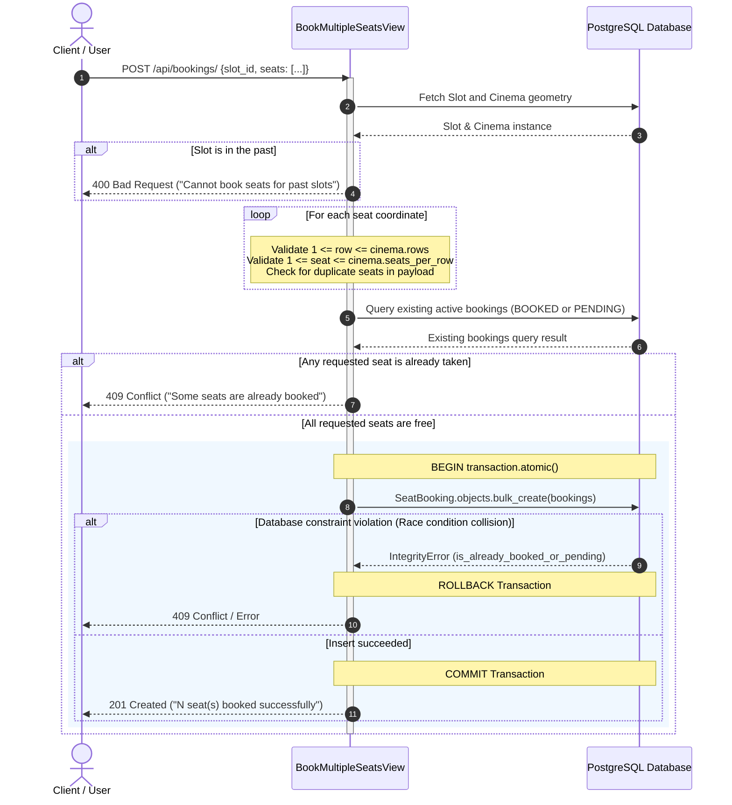
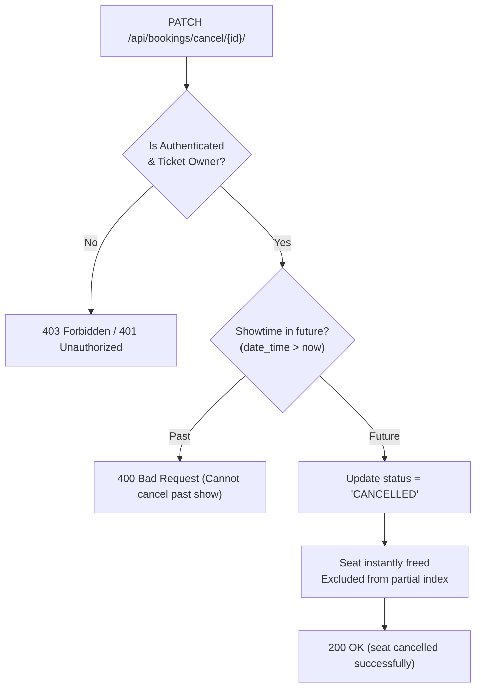

# Architecture - Seat Booking Engine & Concurrency Control

This document explains the technical architecture of the seat booking engine, focusing on concurrency control, race-condition mitigation, validation guarantees, and atomic operations.

---

## 1. Concurrency Problem & Requirements

Movie ticket reservation systems face high concurrency spikes when popular showtimes open for booking. The system must guarantee:
1. **Zero Double-Booking**: Under no circumstances should two different users be allocated the same physical seat for the same showtime.
2. **Atomic Multi-Seat Reservation**: When a user reserves multiple seats (e.g., 4 adjacent seats), the booking must either completely succeed for all 4 seats or fail with zero state mutations.
3. **Boundary Verification**: Seats requested must exist within the cinema's configured dimensions (`rows` and `seats_per_row`).
4. **Instant Re-usability upon Cancellation**: When a seat is cancelled, it must become instantly bookable by other customers without database key collisions.

---

## 2. Booking Sequence Diagram



---

## 3. Defense-in-Depth Concurrency Strategy

The BookMyShow backend employs a three-tier defense-in-depth strategy against double-booking:

### Layer 1: Application-Level Pre-Flight Collision Detection
Before initiating a write, the view constructs a composite `Q` filter representing all requested seats:

```python
query = Q()
for row_number, seat_number in seats:
    query |= Q(row_number=row_number, seat_number=seat_number)

existing = SeatBooking.objects.filter(
    query,
    slot=slot,
    status__in=[BookingStatus.BOOKED, BookingStatus.PENDING],
).exists()

if existing:
    return Response(
        {"message": "Some seats are already booked"},
        status=status.HTTP_409_CONFLICT,
    )
```

This avoids unnecessary database writes and transaction locks when a seat is known to be unavailable.

### Layer 2: ACID Transaction Atomicity (`transaction.atomic()`)
All seat records for a single reservation request are inserted in an atomic block via `bulk_create`:

```python
with transaction.atomic():
    bookings = [
        SeatBooking(
            slot=slot,
            row_number=row,
            seat_number=number,
            user=request.user,
            status=BookingStatus.BOOKED,
        )
        for row, number in seats
    ]
    SeatBooking.objects.bulk_create(bookings)
```

If any single seat fails (or an unhandled error occurs midway), PostgreSQL rolls back the entire batch, preventing orphaned partial reservations.

### Layer 3: Database Partial Unique Constraint (The Safety Net)
The definitive line of defense against sub-millisecond race conditions is implemented directly in PostgreSQL via a conditional partial unique index:

```python
class Meta:
    constraints = [
        models.UniqueConstraint(
            fields=("row_number", "seat_number", "slot"),
            name="is_already_booked_or_pending",
            condition=Q(status=BookingStatus.BOOKED)
            | Q(status=BookingStatus.PENDING),
        )
    ]
```

#### Why a Partial Index?
If a standard `unique_together` constraint were used on `("row_number", "seat_number", "slot")`, once a user booked and later cancelled a seat, no other customer could ever book that seat again without deleting the historical booking row.

With PostgreSQL partial conditional indexes:
- Rows with `status = "BOOKED"` or `status = "PENDING"` must be unique per `(slot, row, seat)`.
- Rows with `status = "CANCELLED"` are excluded from index uniqueness checks, preserving historical audits while freeing up the seat for immediate re-reservation.

---

## 4. Seat Cancellation Workflow

Cancellation is managed via [`apps.seat_booking.views.CancelBookingView`](../../apps/seat_booking/views.py):



1. **Ownership Validation**: The serializer verifies that the requesting user matches `SeatBooking.user`.
2. **Temporal Validation**: Showtimes that have already commenced cannot be cancelled.
3. **Status Mutation**: Changing status to `CANCELLED` instantly removes the row from the active partial index, making the seat immediately available for discovery and reservation on the seat grid.
