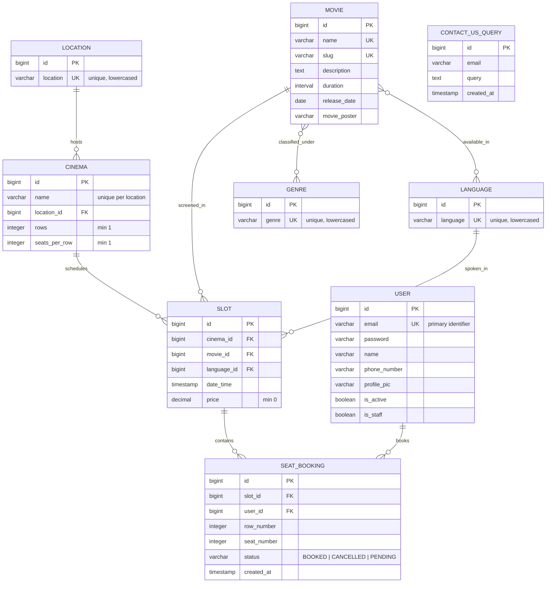

# Architecture - Database Design & ERD

This document specifies the relational data model for the BookMyShow backend, including entity-relationship diagrams, schema definitions, constraints, and data integrity guarantees.

---

## 1. Entity-Relationship Diagram (ERD)



---

## 2. Table Specifications & Models

### 2.1 User (`apps.user.models.User`)
Custom user model substituting Django's default username with an email address.

| Column | Type | Constraints | Description |
| :--- | :--- | :--- | :--- |
| `id` | `BigAutoField` | `PRIMARY KEY` | Unique user identifier |
| `email` | `EmailField` | `UNIQUE, NOT NULL` | Login identifier |
| `password` | `CharField` | `NOT NULL` | PBKDF2 hashed password |
| `name` | `CharField(50)` | `NOT NULL` | Full display name |
| `phone_number` | `CharField(10)` | `NULLABLE` | Contact mobile number |
| `profile_pic` | `ImageField` | `NULLABLE` | Uploaded avatar path |
| `is_active` | `BooleanField` | `DEFAULT TRUE` | Account active state |
| `is_staff` | `BooleanField` | `DEFAULT FALSE` | Access to admin portal |

---

### 2.2 Location (`apps.cinema.models.Location`)
Normalized geographic cities or regions hosting cinema complexes.

| Column | Type | Constraints | Description |
| :--- | :--- | :--- | :--- |
| `id` | `BigAutoField` | `PRIMARY KEY` | Location ID |
| `location` | `CharField(255)` | `UNIQUE, NOT NULL` | Lowercase city name (e.g., `mumbai`, `delhi`) |

---

### 2.3 Cinema (`apps.cinema.models.Cinema`)
Represents an auditorium or multiplex venue with defined grid seating dimensions.

| Column | Type | Constraints | Description |
| :--- | :--- | :--- | :--- |
| `id` | `BigAutoField` | `PRIMARY KEY` | Cinema ID |
| `name` | `CharField(100)` | `NOT NULL` | Cinema venue name |
| `location_id` | `ForeignKey` | `FK -> Location.id (CASCADE)` | Associated city |
| `rows` | `IntegerField` | `MinValueValidator(1)` | Number of seating rows |
| `seats_per_row` | `IntegerField` | `MinValueValidator(1)` | Number of seats per row |

#### Database Constraints:
- `is_name_and_location_unique`: Composite unique constraint on `("name", "location")` preventing duplicate cinema listings within the same city.

---

### 2.4 Movie (`apps.movie.models.Movie`)
Stores movie details, media, classifications, and durations.

| Column | Type | Constraints | Description |
| :--- | :--- | :--- | :--- |
| `id` | `BigAutoField` | `PRIMARY KEY` | Movie ID |
| `name` | `CharField(200)` | `UNIQUE, NOT NULL` | Movie title |
| `slug` | `SlugField` | `UNIQUE, NOT NULL` | URL-safe identifier automatically generated from name |
| `description` | `TextField` | `NOT NULL` | Plot synopsis and details |
| `duration` | `DurationField` | `validate_duration_field` | Length of movie (must be positive) |
| `release_date` | `DateField` | `NOT NULL` | Official theatrical release date |
| `movie_poster` | `ImageField` | `BLANK=TRUE` | Path to movie poster image |

#### Many-to-Many Relationships:
- `languages`: `ManyToManyField -> Language` (`movie_movie_languages`)
- `genres`: `ManyToManyField -> Genre` (`movie_movie_genres`)

---

### 2.5 Slot (`apps.cinema.models.Slot`)
A scheduled movie screening in a specific cinema hall at a given time and ticket price.

| Column | Type | Constraints | Description |
| :--- | :--- | :--- | :--- |
| `id` | `BigAutoField` | `PRIMARY KEY` | Showtime slot ID |
| `cinema_id` | `ForeignKey` | `FK -> Cinema.id (CASCADE)` | Screen location |
| `movie_id` | `ForeignKey` | `FK -> Movie.id (CASCADE)` | Screening title |
| `language_id` | `ForeignKey` | `FK -> Language.id (CASCADE)` | Audio language |
| `date_time` | `DateTimeField`| `NOT NULL` | Show start timestamp |
| `price` | `DecimalField` | `max_digits=8, decimal_places=2, MinValueValidator(0)` | Base ticket cost |

#### Validation & Constraints:
- `cinema_movie_date_time_unique`: Composite unique constraint on `("cinema", "date_time", "movie")`.
- **Runtime Overlap Guard**: `Slot.clean()` ensures:
  1. Selected language is in the movie's supported languages.
  2. Showtime cannot precede the movie's theatrical release date.
  3. No other slot in the same cinema starts before this slot ends or ends after this slot starts.

---

### 2.6 SeatBooking (`apps.seat_booking.models.SeatBooking`)
Individual seat reservation records linked to a specific user and showtime slot.

| Column | Type | Constraints | Description |
| :--- | :--- | :--- | :--- |
| `id` | `BigAutoField` | `PRIMARY KEY` | Booking record ID |
| `slot_id` | `ForeignKey` | `FK -> Slot.id (CASCADE)` | Target showtime |
| `user_id` | `ForeignKey` | `FK -> User.id (CASCADE)` | Ticket holder |
| `row_number` | `IntegerField` | `MinValueValidator(1)` | Row index (1 to cinema.rows) |
| `seat_number`| `IntegerField` | `MinValueValidator(1)` | Column index (1 to cinema.seats_per_row) |
| `status` | `CharField` | `BOOKED | CANCELLED | PENDING` | Current ticket status |
| `created_at` | `DateTimeField`| `DEFAULT timezone.now` | Booking timestamp |

#### Partial Unique Index:
```python
models.UniqueConstraint(
    fields=("row_number", "seat_number", "slot"),
    name="is_already_booked_or_pending",
    condition=Q(status=BookingStatus.BOOKED) | Q(status=BookingStatus.PENDING),
)
```
> [!IMPORTANT]
> The conditional partial index guarantees that two users cannot book or hold the same `(row_number, seat_number, slot)` concurrently, while still allowing a seat that was previously `CANCELLED` to be reserved again without constraint conflicts.

---

### 2.7 ContactUsQuery (`apps.contactus.models.ContactUsQuery`)
Customer support feedback and inquiries.

| Column | Type | Constraints | Description |
| :--- | :--- | :--- | :--- |
| `id` | `BigAutoField` | `PRIMARY KEY` | Query ID |
| `email` | `EmailField` | `NOT NULL` | Submitter contact email |
| `query` | `TextField` | `NOT NULL` | Query description |
| `created_at` | `DateTimeField`| `auto_now_add=True` | Submission timestamp |
