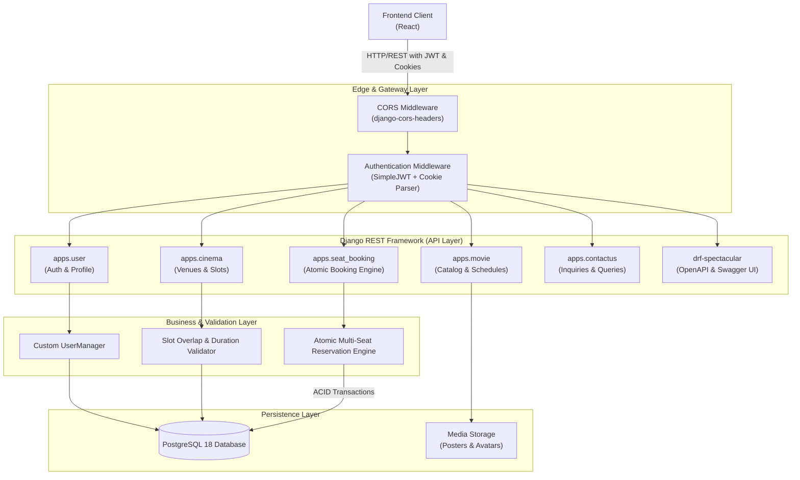

# Architecture - System Overview

This document provides a high-level overview of the architectural design, architectural layers, and component interactions within the BookMyShow backend platform.

---

## 1. High-Level Architecture Diagram

The BookMyShow backend follows a modular, decoupled Layered Architecture built with Django, Django REST Framework, PostgreSQL, and SimpleJWT.

---

## 2. Architectural Layers

### 2.1 Presentation & API Layer (`apps/*/views.py`, `serializers.py`)
- **Framework**: Django REST Framework (DRF) 3.16.
- **Serialization**: DRF Serializers convert complex ORM querysets to JSON and enforce strict payload validation.
- **Documentation**: `drf-spectacular` dynamically generates OpenAPI 3.0 schema definitions directly from serializer and view introspection.

### 2.2 Domain & Business Logic Layer (`apps/*/models.py`, `validators.py`)
- Business rules are encapsulated in model clean methods, custom managers, and database constraints.
- **Showtime Overlap Detection**: The `Slot.clean()` method calculates end times based on movie durations and ensures no two shows overlap in the same hall.
- **Seat Boundary Validation**: Checks incoming row and column numbers against individual cinema dimensions (`rows` and `seats_per_row`).
- **Atomic Operations**: Critical state changes (such as bulk seat booking and fixture seeding) run inside `transaction.atomic()` blocks.

### 2.3 Persistence Layer (PostgreSQL 18)
- Relational storage running in Docker.
- Enforces strict referential integrity via Foreign Keys with cascading deletes where appropriate (`CASCADE`).
- Uses partial conditional indexes (`UniqueConstraint` with filters) to enforce seat locking rules.

---

## 3. Technology Stack & Decision Rationale

| Component | Choice | Rationale |
| :--- | :--- | :--- |
| **Language** | Python 3.14 | Modern typing features, performance improvements, and ecosystem maturity. |
| **Framework** | Django 5.2 | Robust ORM, built-in admin portal, high security standards, and mature migration engine. |
| **API Toolkit** | Django REST Framework | Industry-standard toolkit for REST APIs with serializers, pagination, and view generics. |
| **Authentication** | SimpleJWT + HttpOnly Cookies | Stateless access verification with secure cookie storage mitigating XSS vulnerabilities. |
| **Database** | PostgreSQL 18 | Strong ACID compliance, rich constraint features (partial conditional indexes), and rock-solid reliability. |
| **Documentation** | drf-spectacular (OpenAPI 3.0) | Standardized, interactive API exploration and client generation capability. |
| **Linter / Formatter**| Ruff | High-speed Rust-based code verification ensuring PEP 8 compliance. |

---

## 4. Cross-Cutting Concerns

### 4.1 Security & Authentication
- Passwords are encrypted using Django's PBKDF2 algorithm with custom uppercase, lowercase, numeric, and symbol validation (`apps.user.validators.PasswordValidator`).
- JWT tokens are signed using HMAC-SHA256. Refresh tokens are automatically rotated and tracked in a blacklist database table (`token_blacklist`).

### 4.2 Cross-Origin Resource Sharing (CORS)
- `CORS_ALLOW_CREDENTIALS = True` allows web clients on `http://localhost:3000` to receive and transmit HttpOnly authentication cookies.

### 4.3 Query Optimization & Performance
- ORM queries avoid $N+1$ performance degradation using:
  - `select_related()` for single-valued relationships (`location`, `movie`, `cinema`).
  - `prefetch_related()` for many-to-many and reverse relations (`languages`, `genres`, `slots`).
  - Custom `Prefetch` querysets to apply date and time filters directly at the database level.
